<h1 align="center">
  <br>
  <a href="https://github.com/mohitagw15856/claude-trail">
    <picture>
      <source media="(prefers-color-scheme: dark)" srcset="docs/public/logo-dark.svg">
      <source media="(prefers-color-scheme: light)" srcset="docs/public/logo-light.svg">
      
    </picture>
  </a>
</h1>

<p align="center">
  <a href="README.md">🇬🇧 English</a> •
  <a href="docs/i18n/README.zh.md">🇨🇳 简体中文</a> •
  <a href="docs/i18n/README.zh-tw.md">🇹🇼 繁體中文</a> •
  <a href="docs/i18n/README.md">➕ add your language</a>
</p>

<h4 align="center">A flight recorder for <a href="https://claude.com/claude-code" target="_blank">Claude Code</a>. One log, seven lenses. 🐾</h4>

<p align="center">
  <a href="LICENSE"></a>
  <a href="package.json"></a>
  <a href="package.json"></a>
  <a href="package.json"></a>
  <a href="docs/i18n/README.zh.md"></a>
  <a href="https://github.com/mohitagw15856/claude-trail/actions"></a>
</p>

<p align="center">
  <a href="#quick-start">Quick Start</a> •
  <a href="#the-seven-lenses">Seven Lenses</a> •
  <a href="#how-it-works">How It Works</a> •
  <a href="#中文-mandarin-support">中文</a> •
  <a href="#configuration">Configuration</a> •
  <a href="#privacy">Privacy</a> •
  <a href="#claude-trail-vs-claude-mem">vs claude-mem</a> •
  <a href="#faq">FAQ</a>
</p>

<table align="center">
  <tr>
    <td align="center">
      <a href="https://github.com/mohitagw15856/claude-trail">
        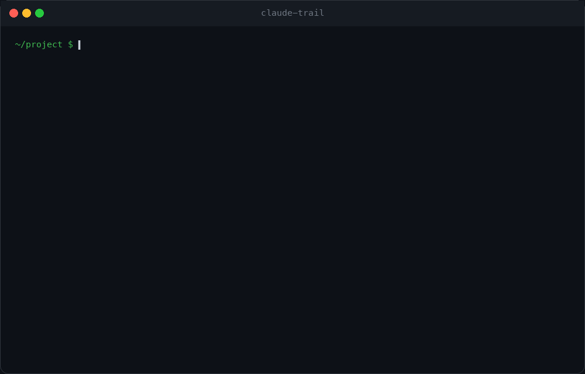
      </a>
    </td>
    <td align="center">
      <a href="https://www.star-history.com/#mohitagw15856/claude-trail&Date">
        <picture>
          <source media="(prefers-color-scheme: dark)" srcset="https://api.star-history.com/image?repos=mohitagw15856/claude-trail&type=date&theme=dark&legend=top-left">
          <source media="(prefers-color-scheme: light)" srcset="https://api.star-history.com/image?repos=mohitagw15856/claude-trail&type=date&legend=top-left">
          
        </picture>
      </a>
    </td>
  </tr>
</table>

<p align="center">
  Claude leaves footprints. claude-trail follows them.<br>
  Every session is recorded to one local log. Seven lenses read it back: a <b>handoff</b> you wake up to, <b>blame</b> for every line Claude wrote, what each session <b>cost</b>, the <b>rules</b> you keep repeating, a nightly <b>digest</b>, an Obsidian <b>vault</b>, and a portable memory <b>passport</b>.<br>
  No daemon. No database. No API key. No network. Zero runtime dependencies. English and 中文 from day one.
</p>

---

## Quick Start

Install from the plugin marketplace inside Claude Code:

```bash
/plugin marketplace add mohitagw15856/claude-trail
/plugin install trail
```

Or with one command from a terminal:

```bash
npx claude-trail install
```

Restart Claude Code. That is it. Your next session leaves footprints, and the one after that starts like this:

<p align="center">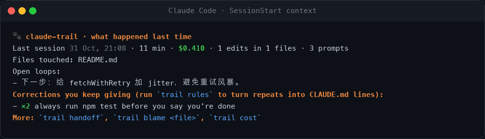</p>

Prefer 中文? One command, everywhere:

```bash
npx claude-trail lang zh
```

> **Note:** `npm install -g claude-trail` gives you the `trail` CLI but does **not** register hooks. Use `npx claude-trail install` or the `/plugin` commands above.

**Key Features:**

- 🤝 **Handoff you wake up to** - a `HANDOFF.md` written at the end of every session and injected at the start of the next. Deterministic, no model call, no key.
- 🔍 **Blame for AI code** - `trail blame src/retry.ts` shows which session and which prompt wrote each line. Human edits stay human.
- 💸 **Exact cost per session** - reads the cost Claude Code itself records. Falls back to a price table when it has to, and says so.
- 🌱 **Rules that grow themselves** - every "don't", "always", "不要", "以后都" you type is a correction. Repeats become `CLAUDE.md` lines with one command.
- 📰 **Digest across projects** - what Claude did today, in every repo, to your terminal or Telegram.
- 🗄️ **Obsidian vault** - sessions as notes, files as notes, backlinks between them.
- 🛂 **Memory passport** - export preferences and project knowledge in the [memory-passport](https://github.com/mohitagw15856/memory-passport) format. Take them to any assistant.
- 🔒 **Private by default** - secrets redacted at write time, `<private>` tags dropped, log gitignored, nothing leaves your machine.
- 🇨🇳 **中文** - every string, every lens, and correction detection in Mandarin.
- ⚡ **Fast** - each hook is one short-lived Node process that appends one line. Under 50 ms. Claude never waits.

---

## The Seven Lenses

One log. Each lens is a question you can ask it.

| Lens | Command | The question it answers |
|---|---|---|
| 🤝 Handoff | `trail handoff` | Where did we leave off? |
| 🔍 Blame | `trail blame <file>` | Which prompt wrote this line? |
| 💸 Cost | `trail cost` | What did that session cost me? |
| 🌱 Rules | `trail rules` | What do I keep telling Claude? |
| 📰 Digest | `trail digest --all` | What did Claude do today, everywhere? |
| 🗄️ Vault | `trail vault` | Can I browse this in Obsidian? |
| 🛂 Passport | `trail export` | Can I take this memory elsewhere? |

### 🤝 Handoff

Written on every `Stop` and `SessionEnd`, so it survives crashes and closed laptops. Injected at `SessionStart`, trimmed to a dozen lines so it costs almost nothing in tokens.

<p align="center">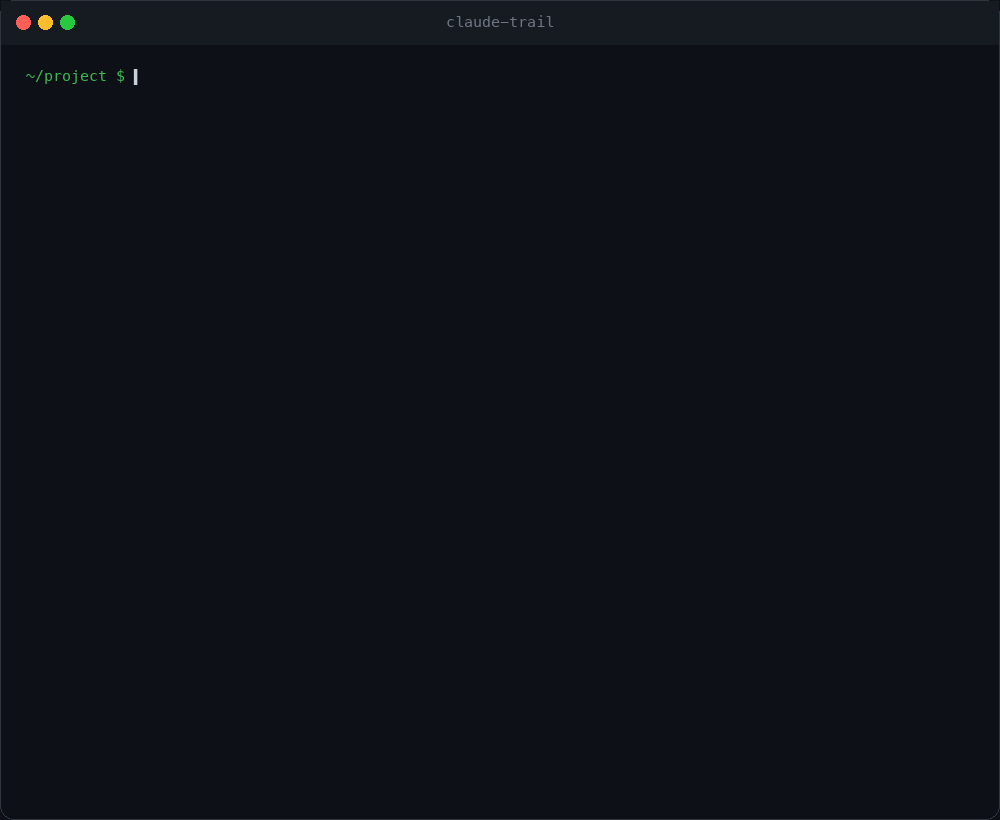</p>

By default it lives at `.claude-trail/HANDOFF.md`. Point it at your own file and claude-trail only touches the block between its markers:

```bash
trail config handoff.path HANDOFF.md
```

### 🔍 Blame

`git blame` tells you who committed a line. `trail blame` tells you which **prompt** produced it.

<p align="center">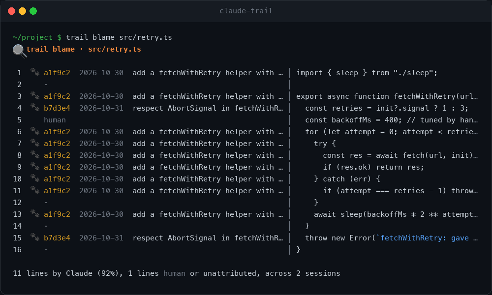</p>

Lines are matched by content, not by git history, so it works on uncommitted files and survives reformatting of other lines. A line you edit by hand stops matching and flips back to `human`. Blank lines and lone braces are never attributed. `--summary` for the percentages only, `--json` for tooling.

### 💸 Cost

<p align="center">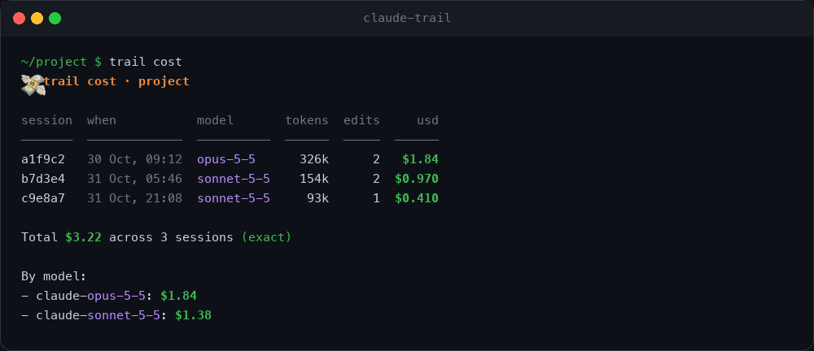</p>

Claude Code writes an exact running cost into each transcript. claude-trail reads it. When a transcript predates that record it estimates from a price table and labels the total `estimated`. Add it to your status line:

```json
"statusLine": { "type": "command", "command": "trail statusline" }
```

### 🌱 Rules

<p align="center">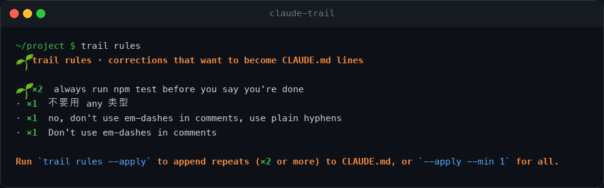</p>

Corrections are detected at prompt time in English and 中文, clustered by meaning, and counted. `trail rules --apply` appends everything you have said twice or more to `CLAUDE.md` under a managed heading. It never adds the same rule twice.

### 📰 Digest

<p align="center">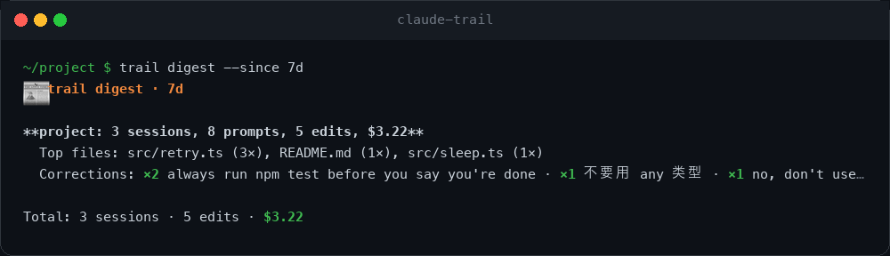</p>

```bash
trail digest --since 24h --all            # every project claude-trail has seen
trail digest --since 7d --all --telegram  # send it
```

For a nightly message, see [docs/digest.md](docs/digest.md) for the cron and launchd snippets.

### 🗄️ Vault

<p align="center">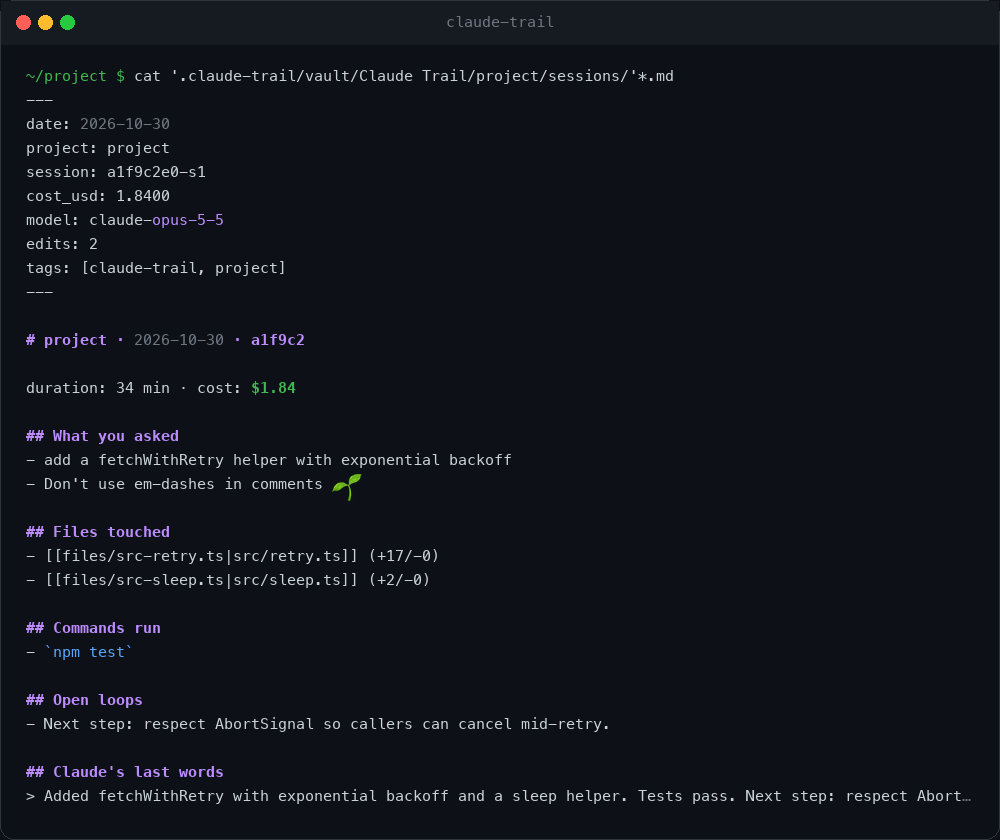</p>

`trail vault ~/Obsidian/MyVault` writes one note per session, one note per touched file, and an index. Session notes link to file notes and back, so Obsidian's graph shows which files Claude keeps returning to.

### 🛂 Passport

<p align="center">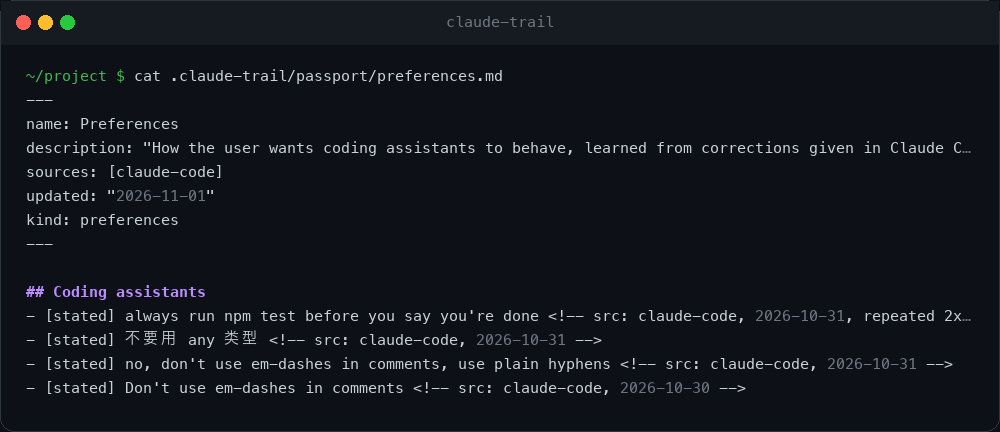</p>

`trail export` writes a [memory-passport](https://github.com/mohitagw15856/memory-passport) vault: `preferences.md` from your corrections, `areas/<project>.md` from the work itself, every fact provenance-tagged. `trail import <vault>` pulls preferences back in as rule candidates. Your memory is a folder of markdown, not a vendor's database.

---

## 中文 (Mandarin support)

claude-trail speaks Mandarin from the first commit, not as an afterthought.

```bash
trail lang zh              # for every project
trail lang zh --project    # for this project only
TRAIL_LANG=zh trail cost   # for one command
```

Claude Code's session context, the handoff file, every lens, and the CLI help all switch. The correction detector understands 不要, 别, 永远不, 以后都, 总是, 每次, 请用, 改用, 不是这样, 错了, 应该, 必须, 记得, 下次. Open loops are extracted from Claude's 下一步 and 未完成 lines as well as its English ones.

<p align="center">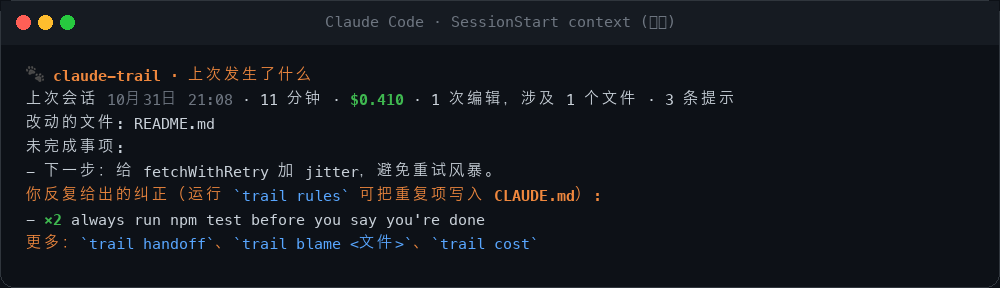</p>
<p align="center">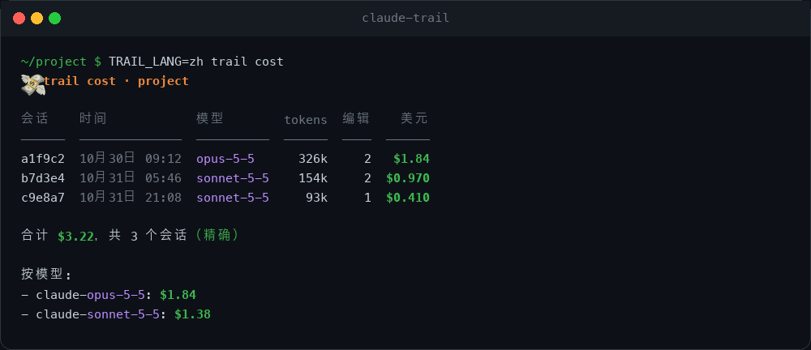</p>

The README is available in [简体中文](docs/i18n/README.zh.md) and [繁體中文](docs/i18n/README.zh-tw.md). Translations of the CLI live in one file per language under [`src/i18n/`](src/i18n/), and a test fails if a key is missing. Adding a language is a pull request with one file.

---

## How It Works

<p align="center">
  <picture>
    <source media="(prefers-color-scheme: dark)" srcset="docs/public/architecture-dark.svg">
    <source media="(prefers-color-scheme: light)" srcset="docs/public/architecture-light.svg">
    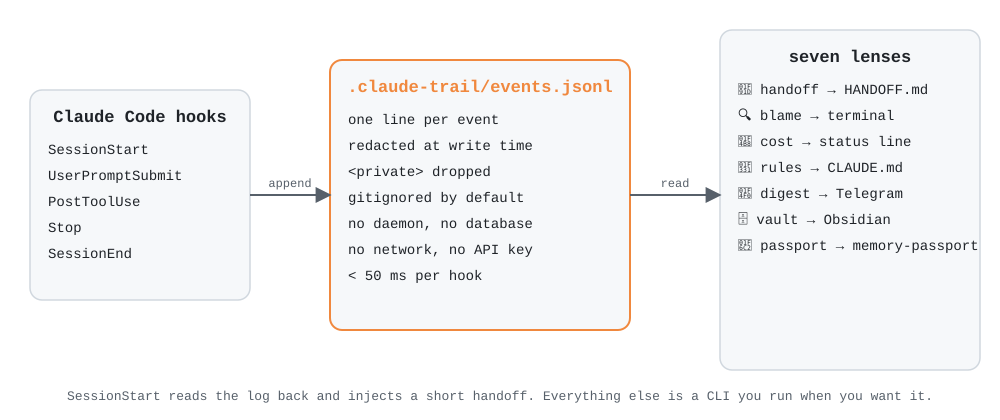
  </picture>
</p>

**Core components:**

1. **Lifecycle hooks** - `SessionStart`, `UserPromptSubmit`, `PostToolUse` (Edit, Write, MultiEdit, NotebookEdit, Bash), `Stop`, `SessionEnd`. Each one is a single `node dist/hook.js <event>` process that appends one JSON line and exits 0, no matter what.
2. **The log** - `.claude-trail/events.jsonl` in the project. Prompts, tool calls with line hashes for blame, cost snapshots from the transcript, and session boundaries. Redaction happens before the write.
3. **The lenses** - plain functions over the log. Nothing is precomputed, nothing is cached, nothing runs in the background.
4. **A project registry** - `~/.claude-trail/projects.json` so `trail digest --all` knows where you have been.

There is no worker, no vector database, no embedding model, no Python. The whole runtime is TypeScript compiled to a few files, with zero npm dependencies.

See [docs/architecture.md](docs/architecture.md) for the event schema and [docs/lenses.md](docs/lenses.md) for every flag.

---

## Configuration

Settings live in `~/.claude-trail/settings.json` (global) and `.claude-trail/config.json` (per project). The CLI writes them for you:

| Command | What it sets |
|---|---|
| `trail lang zh` | Output language, `en` or `zh` |
| `trail config commit on` | Commit the log to git instead of ignoring it (blame across machines) |
| `trail config handoff.path HANDOFF.md` | Where the handoff is written |
| `trail config vault.dir ~/Obsidian/Vault` | Default Obsidian vault |
| `trail config telegram <token> <chatId>` | Digest delivery |
| `trail config name "Fare Deck"` | Project display name |

Environment variables: `TRAIL_LANG`, `CLAUDE_TRAIL_HOME`, `TRAIL_TELEGRAM_BOT_TOKEN`, `TRAIL_TELEGRAM_CHAT_ID`, `TRAIL_DEBUG=1` to see hook errors on stderr.

Pricing for estimates can be overridden under `"pricing"` in the global settings. See [docs/configuration.md](docs/configuration.md).

---

## Privacy

- Everything stays on your machine. The only network call in the codebase is `trail digest --telegram`, and only when you run it.
- API keys, tokens, JWTs, private keys, `password=` pairs and URL credentials are redacted **before** they are written.
- Wrap anything in `<private>...</private>` in a prompt and it is dropped from the log entirely.
- `.claude-trail/` ships with its own `.gitignore`. Opt in to committing with `trail config commit on`.
- Prompts are truncated to 500 characters. Tool outputs are never stored, only the command and the edited lines' hashes.
- `trail log` shows you exactly what was recorded. `rm -rf .claude-trail` forgets it.

---

## claude-trail vs claude-mem

[claude-mem](https://github.com/thedotmack/claude-mem) is excellent and this project would not exist without it. They answer different questions.

| | claude-mem | claude-trail |
|---|---|---|
| Remembers | what Claude **learned** | what Claude **did**, what it **cost**, what you **corrected** |
| Storage | SQLite + Chroma vector DB, Bun worker | one JSONL file |
| Needs a model | yes, to compress observations | no |
| Needs an account | optional, for the hosted observer | never |
| Search | semantic, three-layer MCP tools | `grep`, and seven purpose-built lenses |
| Blame for AI code | | ✅ |
| Cost per session | | ✅ |
| Corrections to CLAUDE.md | | ✅ |
| Obsidian / passport export | | ✅ |
| Runtime dependencies | several | 0 |

They do not conflict. Run both.

---

## Documentation

- [Architecture](docs/architecture.md) - event schema, hook timing, what is and is not stored
- [Lenses](docs/lenses.md) - every command and flag
- [Configuration](docs/configuration.md) - settings files, env vars, pricing overrides
- [Digest](docs/digest.md) - nightly delivery with cron, launchd, Telegram
- [中文支持](docs/mandarin.md) - how localisation works and how to add a language
- [Troubleshooting](docs/troubleshooting.md)
- [Contributing](CONTRIBUTING.md)

---

## Troubleshooting

```bash
trail doctor
```

checks Node, hooks, the log and the language in one go. Common fixes:

- **Nothing is recorded.** Hooks were added while Claude Code was running. Restart it.
- **`trail: command not found`.** You installed via the marketplace, which does not put `trail` on PATH. Use `npx claude-trail <command>` or `npm install -g claude-trail`.
- **Cost shows `estimated`.** The transcript has no `cost-state` record yet. It appears after the first full turn.
- **Blame shows `human` for Claude's lines.** The line was reformatted after Claude wrote it (prettier, eslint --fix). Hashes are of trimmed line content, so indentation changes are fine but wrapping is not.

See [docs/troubleshooting.md](docs/troubleshooting.md).

---

## FAQ

**Does it slow Claude down?** Each hook is a fresh Node process that appends one line. On a 2020 laptop that is 30 to 50 ms, well under the hook timeout, and Claude does not wait for `Stop` or `SessionEnd` hooks at all.

**Does it call an API?** No. The handoff is rendered from the log, not summarised by a model. If you want prose, pipe it: `trail handoff --print | claude -p "summarise in three lines"`.

**What about other agents?** Claude Code only, for now. The log format is deliberately boring JSONL so adapters for Codex, Cursor or OpenCode are small. PRs welcome.

**Why is the plugin called `trail` and the repo `claude-trail`?** Anthropic's plugin directory rejects plugin names that start with `claude-` so third-party plugins cannot pass as official ones. The repo and the npm package keep the descriptive name; the plugin you install is `trail`.

**Why "trail"?** Claude leaves footprints. 🐾

---

## Contributing

Bug reports, lenses, and translations are all welcome. Start with [CONTRIBUTING.md](CONTRIBUTING.md). The demo GIFs are rendered from real CLI output by `npm run media`, so if you change an output format, regenerate them.

## Star History

<a href="https://www.star-history.com/#mohitagw15856/claude-trail&Date">
  <picture>
    <source media="(prefers-color-scheme: dark)" srcset="https://api.star-history.com/image?repos=mohitagw15856/claude-trail&type=date&theme=dark">
    <source media="(prefers-color-scheme: light)" srcset="https://api.star-history.com/image?repos=mohitagw15856/claude-trail&type=date">
    
  </picture>
</a>

## License

[Apache 2.0](LICENSE). claude-trail is an independent community project and is not affiliated with or endorsed by Anthropic. "Claude" is a trademark of Anthropic, PBC.
