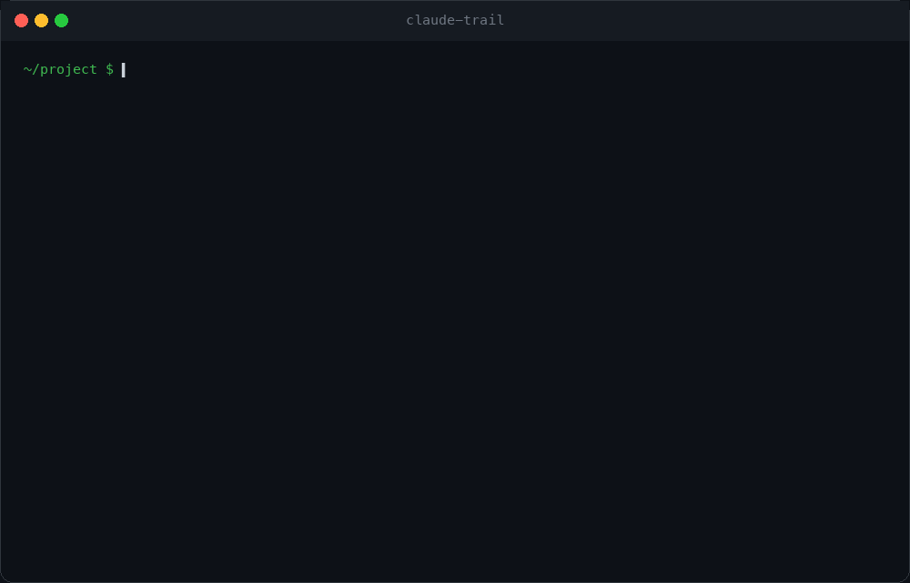
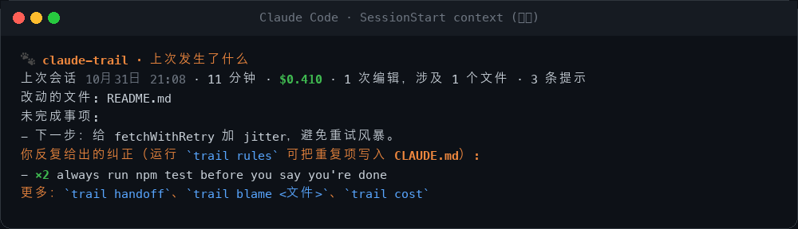
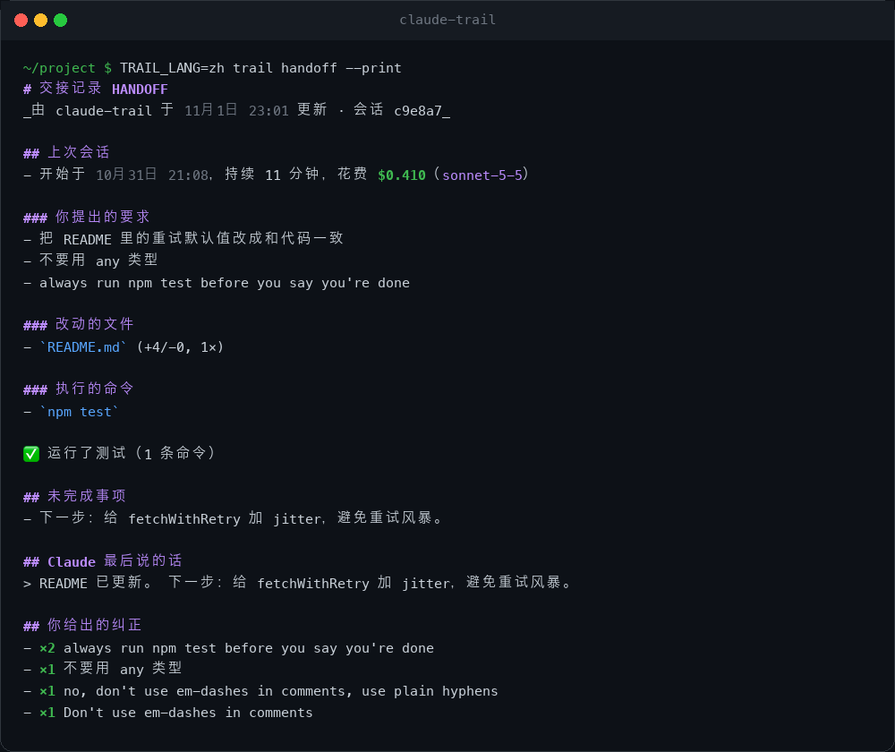
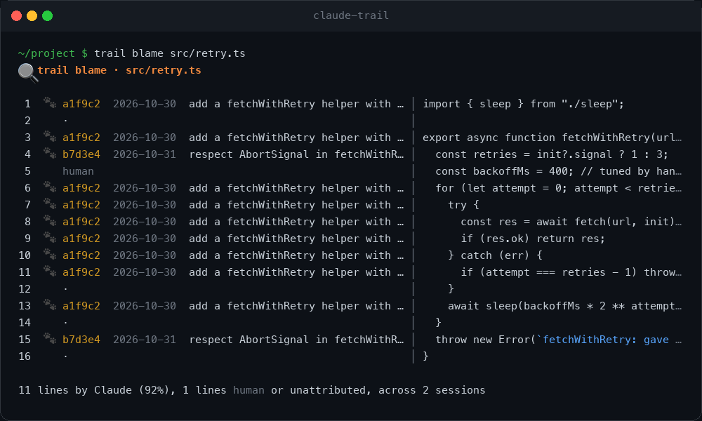
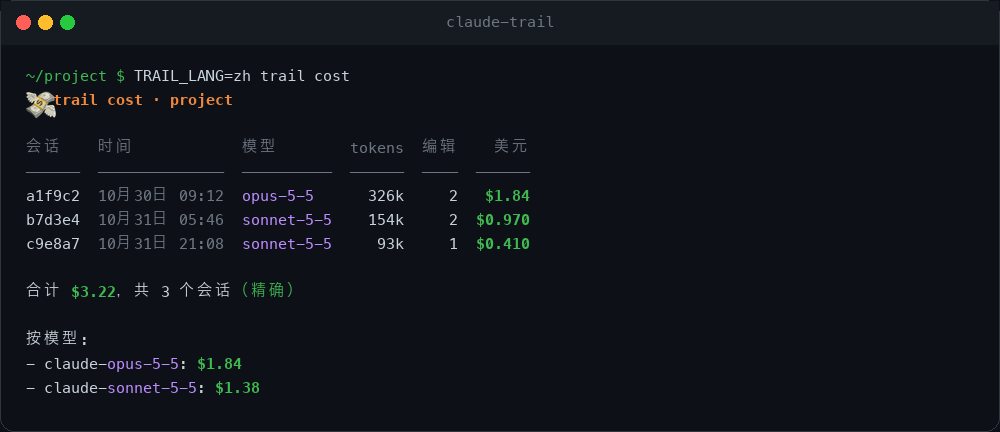
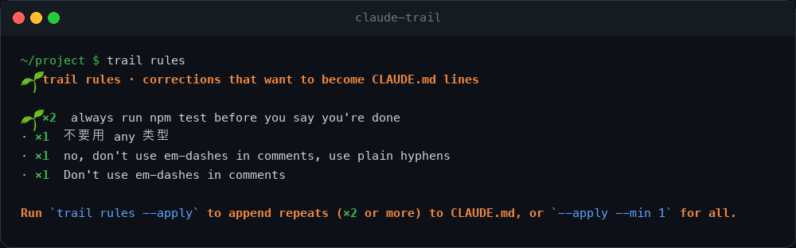
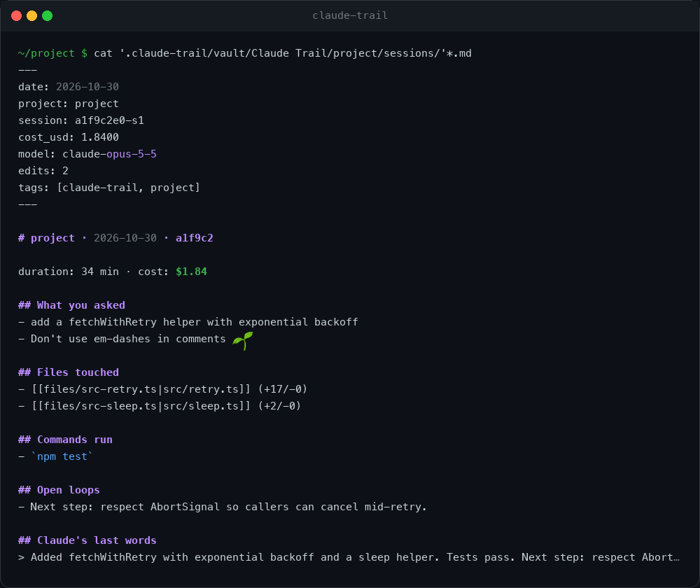
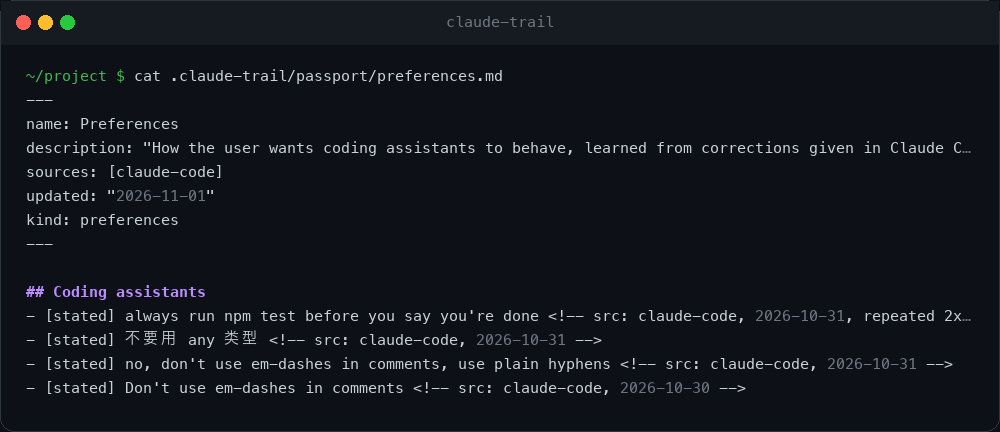
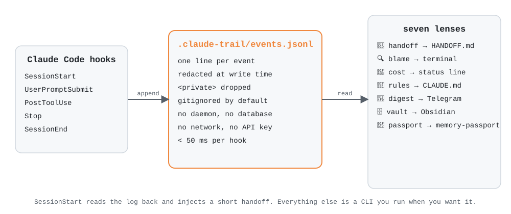

<h1 align="center">
  <br>
  <a href="https://github.com/mohitagw15856/claude-trail">
    <picture>
      <source media="(prefers-color-scheme: dark)" srcset="../public/logo-dark.svg">
      <source media="(prefers-color-scheme: light)" srcset="../public/logo-light.svg">
      
    </picture>
  </a>
</h1>

<p align="center">
  <a href="../../README.md">🇬🇧 English</a> •
  <a href="README.zh.md">🇨🇳 简体中文</a> •
  <a href="README.zh-tw.md">🇹🇼 繁體中文</a> •
  <a href="README.md">➕ 新增你的語言</a>
</p>

<h4 align="center"><a href="https://claude.com/claude-code" target="_blank">Claude Code</a> 的飛行記錄器。一份日誌，七個鏡頭。🐾</h4>

<p align="center">
  <a href="../../LICENSE"></a>
  <a href="../../package.json"></a>
  <a href="../../package.json"></a>
  <a href="../../package.json"></a>
</p>

<p align="center">
  
</p>

<p align="center">
  Claude 會留下足跡，claude-trail 負責追蹤。<br>
  每一次工作階段都記錄到一份本機日誌。七個鏡頭讀取它：醒來就能看到的<b>交接記錄</b>，Claude 寫的每一行程式碼的<b>歸屬</b>，每個工作階段的<b>花費</b>，你反覆強調的<b>規則</b>，每晚的<b>摘要</b>，Obsidian <b>筆記庫</b>，以及可以帶走的記憶<b>護照</b>。<br>
  沒有常駐程式，沒有資料庫，不需要 API 金鑰，不連網，零執行時依賴。英文與中文從第一天起就同時支援。
</p>

---

## 快速開始

在 Claude Code 裡透過外掛市集安裝：

```bash
/plugin marketplace add mohitagw15856/claude-trail
/plugin install trail
```

或者在終端機用一條指令：

```bash
npx claude-trail install
npx claude-trail lang zh
```

重新啟動 Claude Code。就這樣。下一次工作階段會留下足跡，再下一次會這樣開始：

<p align="center"></p>

> **注意：** `npm install -g claude-trail` 只會安裝 `trail` 指令列，**不會**註冊 hook。請使用 `npx claude-trail install` 或上面的 `/plugin` 指令。

**主要特色：**

- 🤝 **醒來就有交接記錄** - 每次工作階段結束時寫入 `HANDOFF.md`，下次開始時注入。完全確定性產生，不呼叫模型，不需要金鑰。
- 🔍 **AI 程式碼的 blame** - `trail blame src/retry.ts` 顯示每一行是哪個工作階段、哪條提示寫出來的。人工修改的行維持為「人工」。
- 💸 **每個工作階段的精確花費** - 直接讀取 Claude Code 自己記錄的費用。必要時用價格表估算，並明確標註。
- 🌱 **自動成長的規則** - 你輸入的每一句「不要」「總是」「以後都」「don't」「always」都是一次糾正。重複出現的糾正，一條指令就能寫入 `CLAUDE.md`。
- 📰 **跨專案摘要** - Claude 今天在所有儲存庫做了什麼，輸出到終端機或 Telegram。
- 🗄️ **Obsidian 筆記庫** - 工作階段是筆記，檔案也是筆記，兩者互相反向連結。
- 🛂 **記憶護照** - 以 [memory-passport](https://github.com/mohitagw15856/memory-passport) 格式匯出偏好和專案知識，帶到任何助理裡。
- 🔒 **預設私密** - 寫入前就去識別化，`<private>` 標籤內容直接丟棄，日誌預設 gitignore，任何資料都不離開你的電腦。
- 🇹🇼 **中文** - 每一個字串、每一個鏡頭、以及中文糾正辨識。
- ⚡ **快** - 每個 hook 是一個短暫的 Node 程序，追加一行就結束。50 毫秒以內，Claude 從不等待。

---

## 七個鏡頭

| 鏡頭 | 指令 | 它回答的問題 |
|---|---|---|
| 🤝 交接 | `trail handoff` | 上次做到哪裡了？ |
| 🔍 歸屬 | `trail blame <檔案>` | 這一行是哪條提示寫的？ |
| 💸 花費 | `trail cost` | 那次工作階段花了多少錢？ |
| 🌱 規則 | `trail rules` | 我總在跟 Claude 重複什麼？ |
| 📰 摘要 | `trail digest --all` | Claude 今天在各個專案做了什麼？ |
| 🗄️ 筆記庫 | `trail vault` | 能在 Obsidian 裡瀏覽嗎？ |
| 🛂 護照 | `trail export` | 能把這些記憶帶到別處嗎？ |

### 🤝 交接

在每次 `Stop` 和 `SessionEnd` 時寫入，即使當機或闔上筆電也不會遺失。在 `SessionStart` 時注入，精簡到十幾行，幾乎不消耗 token。

<p align="center"></p>

預設位於 `.claude-trail/HANDOFF.md`。指向你自己的檔案後，claude-trail 只會修改標記之間的區塊：

```bash
trail config handoff.path HANDOFF.md
```

### 🔍 歸屬

`git blame` 告訴你誰提交了這一行，`trail blame` 告訴你是哪條**提示**產生了它。

<p align="center"></p>

依內容比對而不是 git 歷史，所以對未提交的檔案也有效。你手動改過的行會不再比對成功，回到「人工」。空行和單獨的大括號從不歸屬。`--summary` 只看百分比，`--json` 給工具用。

### 💸 花費

<p align="center"></p>

Claude Code 會把精確的累計費用寫進每份工作階段記錄，claude-trail 直接讀取。如果記錄裡還沒有這項資料，就用價格表估算，並把合計標為「估算」。加到狀態列：

```json
"statusLine": { "type": "command", "command": "trail statusline" }
```

### 🌱 規則

<p align="center"></p>

糾正在你輸入提示時就被辨識（中英文都支援），依語意聚合並計數。`trail rules --apply` 會把你說過兩次以上的內容追加到 `CLAUDE.md` 的受管標題下，同一條規則不會重複新增。

### 📰 摘要

```bash
trail digest --since 24h --all            # claude-trail 見過的所有專案
trail digest --since 7d --all --telegram  # 送出
```

每晚自動送出的 cron 與 launchd 設定見 [docs/digest.md](../digest.md)。

### 🗄️ 筆記庫

<p align="center"></p>

`trail vault ~/Obsidian/MyVault` 為每個工作階段寫一篇筆記，為每個改動過的檔案寫一篇筆記，外加索引。工作階段筆記連結到檔案筆記，反之亦然，Obsidian 的圖譜會顯示 Claude 反覆回到哪些檔案。

### 🛂 護照

<p align="center"></p>

`trail export` 寫出一個 [memory-passport](https://github.com/mohitagw15856/memory-passport) 記憶庫：`preferences.md` 來自你的糾正，`areas/<專案>.md` 來自實際工作，每條事實都帶來源標籤。`trail import <目錄>` 把偏好作為規則候選匯回來。你的記憶是一個 markdown 資料夾，不是某家廠商的資料庫。

---

## 運作原理

<p align="center">
  <picture>
    <source media="(prefers-color-scheme: dark)" srcset="../public/architecture-dark.svg">
    <source media="(prefers-color-scheme: light)" srcset="../public/architecture-light.svg">
    
  </picture>
</p>

1. **生命週期 hook** - `SessionStart`、`UserPromptSubmit`、`PostToolUse`（Edit、Write、MultiEdit、NotebookEdit、Bash）、`Stop`、`SessionEnd`。每個 hook 是一個 `node dist/hook.js <事件>` 程序，追加一行 JSON 後以 0 結束，無論發生什麼。
2. **日誌** - 專案裡的 `.claude-trail/events.jsonl`。提示、帶行雜湊的工具呼叫（用於歸屬）、來自工作階段記錄的費用快照、工作階段邊界。去識別化在寫入之前完成。
3. **鏡頭** - 對日誌的純函式。不預先計算，不快取，沒有背景程序。
4. **專案登錄表** - `~/.claude-trail/projects.json`，讓 `trail digest --all` 知道你去過哪些專案。

沒有 worker，沒有向量資料庫，沒有 embedding 模型，沒有 Python。整個執行時是編譯成幾個檔案的 TypeScript，零 npm 依賴。

---

## 設定

| 指令 | 作用 |
|---|---|
| `trail lang zh` | 輸出語言，`en` 或 `zh` |
| `trail config commit on` | 把日誌提交到 git 而不是忽略（跨機器歸屬） |
| `trail config handoff.path HANDOFF.md` | 交接記錄寫到哪裡 |
| `trail config vault.dir ~/Obsidian/Vault` | 預設 Obsidian 庫 |
| `trail config telegram <token> <chatId>` | 摘要推送 |
| `trail config name "專案名"` | 專案顯示名稱 |

環境變數：`TRAIL_LANG`、`CLAUDE_TRAIL_HOME`、`TRAIL_TELEGRAM_BOT_TOKEN`、`TRAIL_TELEGRAM_CHAT_ID`，以及 `TRAIL_DEBUG=1` 在 stderr 查看 hook 錯誤。詳見 [docs/configuration.md](../configuration.md)。

---

## 隱私

- 一切都留在你的電腦上。程式碼裡唯一的網路呼叫是 `trail digest --telegram`，而且只在你主動執行時發生。
- API 金鑰、token、JWT、私鑰、`password=` 鍵值對和 URL 中的憑證在寫入**之前**就被去識別化。
- 在提示中用 `<private>...</private>` 包住的內容會被完全丟棄。
- `.claude-trail/` 自帶 `.gitignore`。用 `trail config commit on` 主動選擇提交。
- 提示截斷到 500 個字元。工具輸出從不儲存，只存指令和被編輯行的雜湊。
- `trail log` 讓你看到到底記錄了什麼。`rm -rf .claude-trail` 就全部忘掉。

---

## claude-trail 與 claude-mem

[claude-mem](https://github.com/thedotmack/claude-mem) 非常出色，沒有它就沒有這個專案。兩者回答的是不同的問題。

| | claude-mem | claude-trail |
|---|---|---|
| 記住的是 | Claude **學到了**什麼 | Claude **做了**什麼、**花了**多少、你**糾正**了什麼 |
| 儲存 | SQLite + Chroma 向量庫，Bun worker | 一個 JSONL 檔案 |
| 需要模型 | 需要，用來壓縮觀察 | 不需要 |
| 需要帳號 | 可選，用於託管觀察器 | 從不 |
| AI 程式碼歸屬 | | ✅ |
| 每工作階段花費 | | ✅ |
| 糾正寫入 CLAUDE.md | | ✅ |
| Obsidian / 護照匯出 | | ✅ |
| 執行時依賴 | 若干 | 0 |

它們並不衝突。兩個一起用。

---

## 常見問題

**會拖慢 Claude 嗎？** 每個 hook 是一個新的 Node 程序，追加一行就結束。在 2020 年的筆電上是 30 到 50 毫秒，遠低於 hook 逾時，而且 Claude 不會等待 `Stop` 和 `SessionEnd` hook。

**會呼叫 API 嗎？** 不會。交接記錄是從日誌渲染出來的，不是模型摘要的。想要自然語言摘要可以用管線：`trail handoff --print | claude -p "用三句話總結"`。

**支援其他 agent 嗎？** 目前只支援 Claude Code。日誌格式刻意選擇了平淡的 JSONL，所以 Codex、Cursor、OpenCode 的轉接器會很小。歡迎 PR。

**為什麼外掛叫 `trail`，儲存庫叫 `claude-trail`？** Anthropic 的外掛目錄不接受以 `claude-` 開頭的外掛名稱，以免第三方外掛被誤認為官方外掛。儲存庫和 npm 套件保留描述性的名字，你安裝的外掛叫 `trail`。

**為什麼叫 trail？** Claude 會留下足跡。🐾

---

## 授權

[Apache 2.0](../../LICENSE)。claude-trail 是獨立的社群專案，與 Anthropic 沒有隸屬或背書關係。「Claude」是 Anthropic, PBC 的商標。
