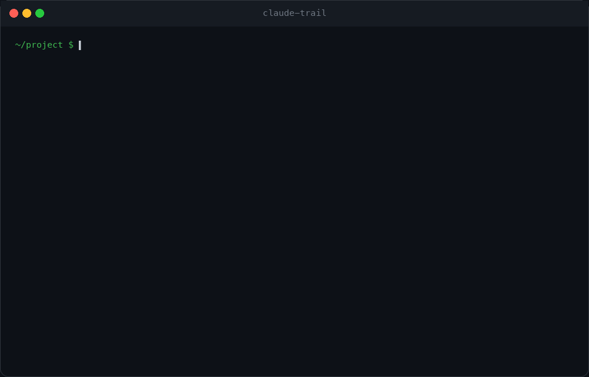
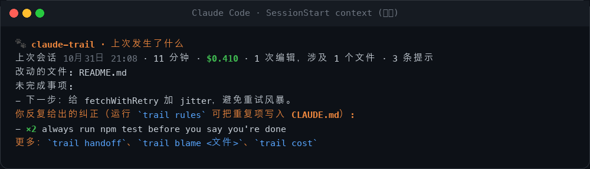
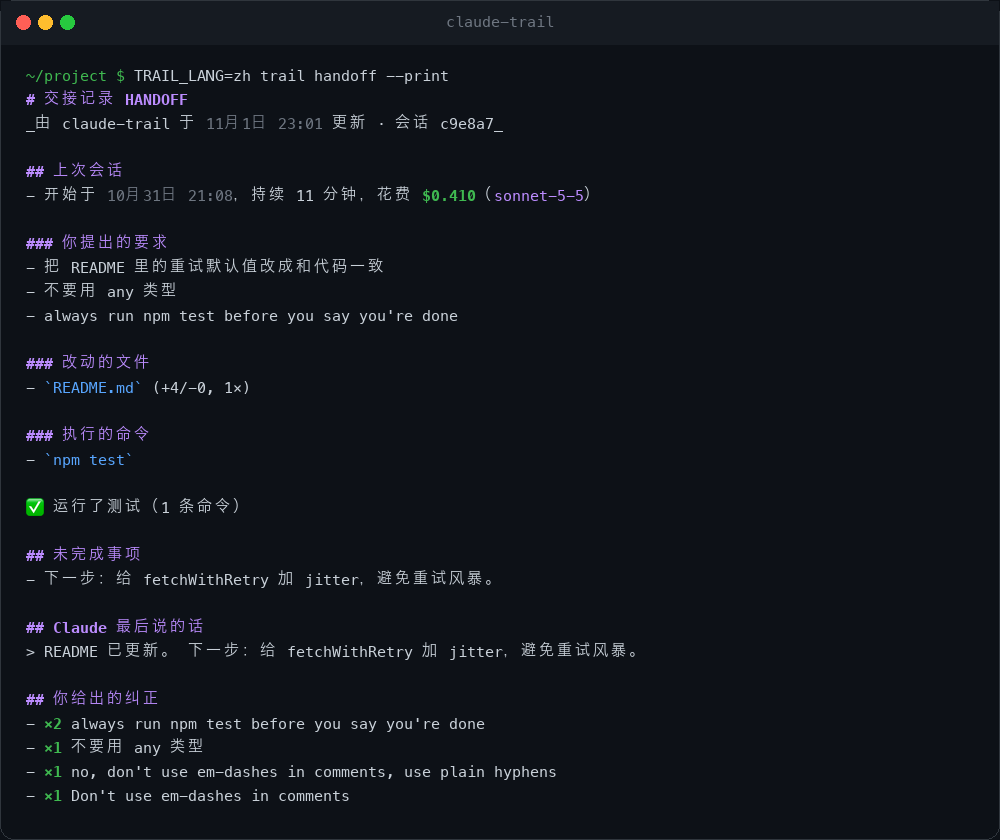
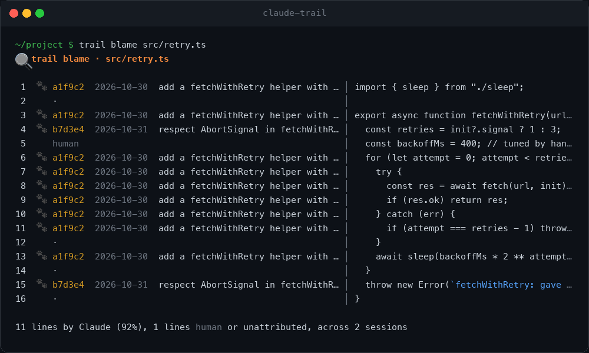
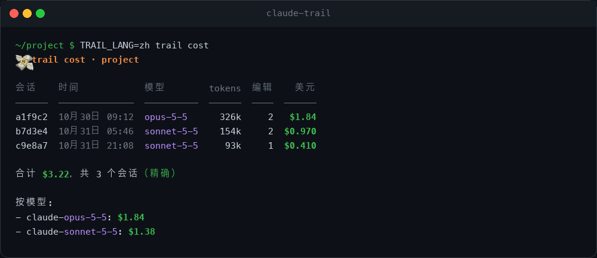
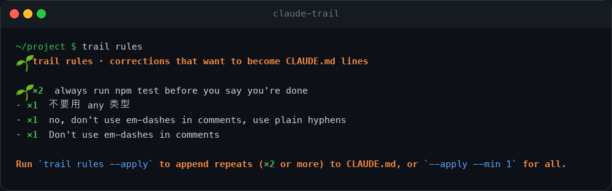
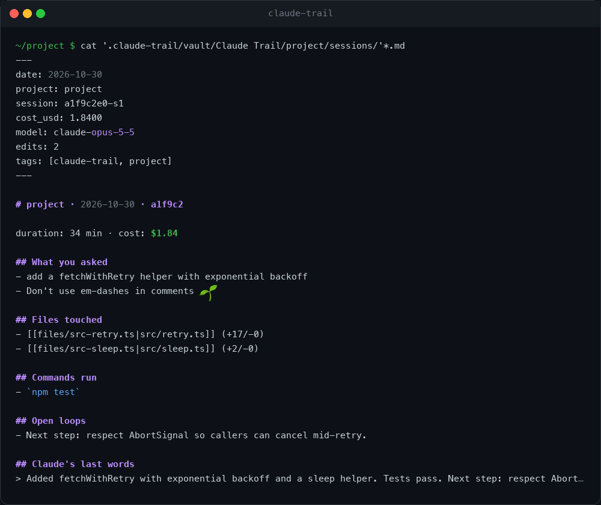
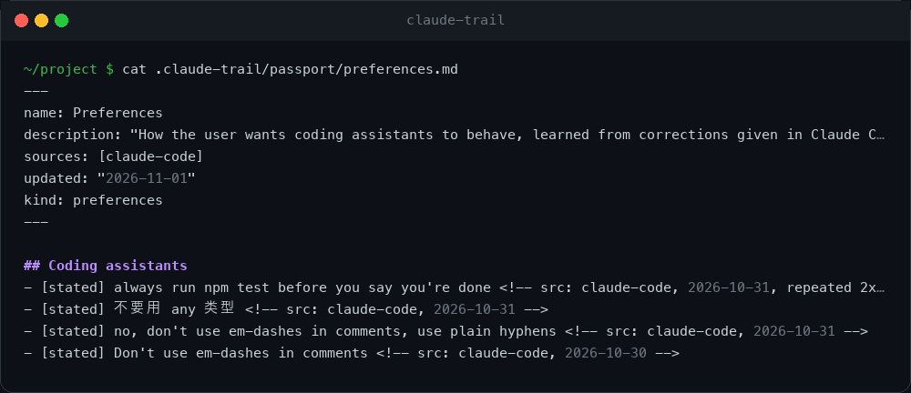
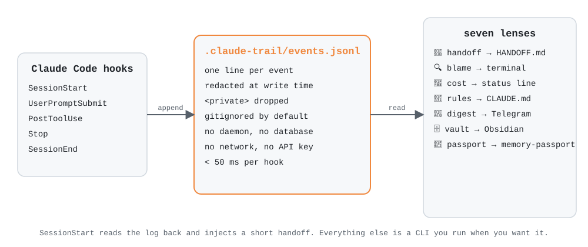

<h1 align="center">
  <br>
  <a href="https://github.com/mohitagw15856/claude-trail">
    <picture>
      <source media="(prefers-color-scheme: dark)" srcset="../public/logo-dark.svg">
      <source media="(prefers-color-scheme: light)" srcset="../public/logo-light.svg">
      
    </picture>
  </a>
</h1>

<p align="center">
  <a href="../../README.md">🇬🇧 English</a> •
  <a href="README.zh.md">🇨🇳 简体中文</a> •
  <a href="README.zh-tw.md">🇹🇼 繁體中文</a> •
  <a href="README.md">➕ 添加你的语言</a>
</p>

<h4 align="center"><a href="https://claude.com/claude-code" target="_blank">Claude Code</a> 的飞行记录仪。一份日志，七个镜头。🐾</h4>

<p align="center">
  <a href="../../LICENSE"></a>
  <a href="../../package.json"></a>
  <a href="../../package.json"></a>
  <a href="../../package.json"></a>
</p>

<p align="center">
  <a href="#快速开始">快速开始</a> •
  <a href="#七个镜头">七个镜头</a> •
  <a href="#工作原理">工作原理</a> •
  <a href="#配置">配置</a> •
  <a href="#隐私">隐私</a> •
  <a href="#claude-trail-与-claude-mem">对比 claude-mem</a> •
  <a href="#常见问题">常见问题</a>
</p>

<p align="center">
  
</p>

<p align="center">
  Claude 会留下足迹，claude-trail 负责跟踪。<br>
  每一次会话都记录到一份本地日志。七个镜头读取它：醒来就能看到的<b>交接记录</b>，Claude 写的每一行代码的<b>归属</b>，每个会话的<b>花费</b>，你反复强调的<b>规则</b>，每晚的<b>摘要</b>，Obsidian <b>笔记库</b>，以及可以带走的记忆<b>护照</b>。<br>
  没有守护进程，没有数据库，不需要 API 密钥，不联网，零运行时依赖。英文和中文从第一天起就同时支持。
</p>

---

## 快速开始

在 Claude Code 里通过插件市场安装：

```bash
/plugin marketplace add mohitagw15856/claude-trail
/plugin install trail
```

或者在终端里用一条命令：

```bash
npx claude-trail install
npx claude-trail lang zh
```

重启 Claude Code。就这样。下一次会话会留下足迹，再下一次会话会这样开始：

<p align="center"></p>

> **注意：** `npm install -g claude-trail` 只会安装 `trail` 命令行，**不会**注册钩子。请使用 `npx claude-trail install` 或上面的 `/plugin` 命令。

**主要特性：**

- 🤝 **醒来就有交接记录** - 每次会话结束时写入 `HANDOFF.md`，下次会话开始时注入。完全确定性生成，不调用模型，不需要密钥。
- 🔍 **AI 代码的 blame** - `trail blame src/retry.ts` 显示每一行是哪个会话、哪条提示写出来的。人工改动的行保持为“人工”。
- 💸 **每个会话的精确花费** - 直接读取 Claude Code 自己记录的费用。必要时用价格表估算，并明确标注。
- 🌱 **自动生长的规则** - 你输入的每一句“不要”“总是”“以后都”“don't”“always”都是一次纠正。重复出现的纠正，一条命令就能写入 `CLAUDE.md`。
- 📰 **跨项目摘要** - Claude 今天在所有仓库里做了什么，输出到终端或 Telegram。
- 🗄️ **Obsidian 笔记库** - 会话是笔记，文件也是笔记，两者互相反向链接。
- 🛂 **记忆护照** - 以 [memory-passport](https://github.com/mohitagw15856/memory-passport) 格式导出偏好和项目知识，带到任何助手里。
- 🔒 **默认私密** - 写入前就脱敏，`<private>` 标签内容直接丢弃，日志默认 gitignore，任何数据都不离开你的电脑。
- 🇨🇳 **中文** - 每一个字符串、每一个镜头、以及中文纠正识别。
- ⚡ **快** - 每个钩子是一个短暂的 Node 进程，追加一行就退出。50 毫秒以内，Claude 从不等待。

---

## 七个镜头

一份日志。每个镜头是你可以向它提出的一个问题。

| 镜头 | 命令 | 它回答的问题 |
|---|---|---|
| 🤝 交接 | `trail handoff` | 上次做到哪里了？ |
| 🔍 归属 | `trail blame <文件>` | 这一行是哪条提示写的？ |
| 💸 花费 | `trail cost` | 那次会话花了多少钱？ |
| 🌱 规则 | `trail rules` | 我总在跟 Claude 重复什么？ |
| 📰 摘要 | `trail digest --all` | Claude 今天在各个项目里做了什么？ |
| 🗄️ 笔记库 | `trail vault` | 能在 Obsidian 里浏览吗？ |
| 🛂 护照 | `trail export` | 能把这些记忆带到别处吗？ |

### 🤝 交接

在每次 `Stop` 和 `SessionEnd` 时写入，所以即使崩溃或合上笔记本也不会丢。在 `SessionStart` 时注入，精简到十几行，几乎不消耗 token。

<p align="center"></p>

默认位于 `.claude-trail/HANDOFF.md`。指向你自己的文件后，claude-trail 只会修改标记之间的区块：

```bash
trail config handoff.path HANDOFF.md
```

### 🔍 归属

`git blame` 告诉你谁提交了这一行，`trail blame` 告诉你是哪条**提示**产生了它。

<p align="center"></p>

按内容匹配而不是按 git 历史，所以对未提交的文件也有效。你手动改过的行会不再匹配，回到“人工”。空行和单独的大括号从不归属。`--summary` 只看百分比，`--json` 给工具用。

### 💸 花费

<p align="center"></p>

Claude Code 会把精确的累计费用写进每份会话记录，claude-trail 直接读取。如果记录里还没有这项数据，就用价格表估算，并把合计标为“估算”。加到状态栏：

```json
"statusLine": { "type": "command", "command": "trail statusline" }
```

### 🌱 规则

<p align="center"></p>

纠正在你输入提示时就被识别（中英文都支持），按语义聚合并计数。`trail rules --apply` 会把你说过两次及以上的内容追加到 `CLAUDE.md` 的受管标题下，同一条规则不会重复添加。

### 📰 摘要

```bash
trail digest --since 24h --all            # claude-trail 见过的所有项目
trail digest --since 7d --all --telegram  # 发送出去
```

每晚自动发送的 cron 和 launchd 配置见 [docs/digest.md](../digest.md)。

### 🗄️ 笔记库

<p align="center"></p>

`trail vault ~/Obsidian/MyVault` 为每个会话写一篇笔记，为每个改动过的文件写一篇笔记，外加一个索引。会话笔记链接到文件笔记，反之亦然，Obsidian 的图谱会显示 Claude 反复回到哪些文件。

### 🛂 护照

<p align="center"></p>

`trail export` 写出一个 [memory-passport](https://github.com/mohitagw15856/memory-passport) 记忆库：`preferences.md` 来自你的纠正，`areas/<项目>.md` 来自实际工作，每条事实都带来源标签。`trail import <目录>` 把偏好作为规则候选导回来。你的记忆是一个 markdown 文件夹，不是某家厂商的数据库。

---

## 工作原理

<p align="center">
  <picture>
    <source media="(prefers-color-scheme: dark)" srcset="../public/architecture-dark.svg">
    <source media="(prefers-color-scheme: light)" srcset="../public/architecture-light.svg">
    
  </picture>
</p>

1. **生命周期钩子** - `SessionStart`、`UserPromptSubmit`、`PostToolUse`（Edit、Write、MultiEdit、NotebookEdit、Bash）、`Stop`、`SessionEnd`。每个钩子是一个 `node dist/hook.js <事件>` 进程，追加一行 JSON 后以 0 退出，无论发生什么。
2. **日志** - 项目里的 `.claude-trail/events.jsonl`。提示、带行哈希的工具调用（用于归属）、来自会话记录的费用快照、会话边界。脱敏在写入之前完成。
3. **镜头** - 对日志的纯函数。不预计算，不缓存，没有后台进程。
4. **项目注册表** - `~/.claude-trail/projects.json`，让 `trail digest --all` 知道你去过哪些项目。

没有 worker，没有向量数据库，没有 embedding 模型，没有 Python。整个运行时是编译成几个文件的 TypeScript，零 npm 依赖。

事件结构见 [docs/architecture.md](../architecture.md)，所有参数见 [docs/lenses.md](../lenses.md)。

---

## 配置

全局设置在 `~/.claude-trail/settings.json`，项目设置在 `.claude-trail/config.json`。命令行会帮你写：

| 命令 | 作用 |
|---|---|
| `trail lang zh` | 输出语言，`en` 或 `zh` |
| `trail config commit on` | 把日志提交到 git 而不是忽略（跨机器归属） |
| `trail config handoff.path HANDOFF.md` | 交接记录写到哪里 |
| `trail config vault.dir ~/Obsidian/Vault` | 默认 Obsidian 库 |
| `trail config telegram <token> <chatId>` | 摘要推送 |
| `trail config name "项目名"` | 项目显示名称 |

环境变量：`TRAIL_LANG`、`CLAUDE_TRAIL_HOME`、`TRAIL_TELEGRAM_BOT_TOKEN`、`TRAIL_TELEGRAM_CHAT_ID`，以及 `TRAIL_DEBUG=1` 在 stderr 查看钩子错误。详见 [docs/configuration.md](../configuration.md)。

---

## 隐私

- 一切都留在你的电脑上。代码库里唯一的网络调用是 `trail digest --telegram`，而且只在你主动运行时发生。
- API 密钥、token、JWT、私钥、`password=` 键值对和 URL 中的凭据在写入**之前**就被脱敏。
- 在提示中用 `<private>...</private>` 包住的内容会被完全丢弃。
- `.claude-trail/` 自带 `.gitignore`。用 `trail config commit on` 主动选择提交。
- 提示截断到 500 个字符。工具输出从不存储，只存命令和被编辑行的哈希。
- `trail log` 让你看到到底记录了什么。`rm -rf .claude-trail` 就全部忘掉。

---

## claude-trail 与 claude-mem

[claude-mem](https://github.com/thedotmack/claude-mem) 非常出色，没有它就没有这个项目。两者回答的是不同的问题。

| | claude-mem | claude-trail |
|---|---|---|
| 记住的是 | Claude **学到了**什么 | Claude **做了**什么、**花了**多少、你**纠正**了什么 |
| 存储 | SQLite + Chroma 向量库，Bun worker | 一个 JSONL 文件 |
| 需要模型 | 需要，用来压缩观察 | 不需要 |
| 需要账号 | 可选，用于托管观察器 | 从不 |
| 搜索 | 语义搜索，三层 MCP 工具 | `grep`，加七个专用镜头 |
| AI 代码归属 | | ✅ |
| 每会话花费 | | ✅ |
| 纠正写入 CLAUDE.md | | ✅ |
| Obsidian / 护照导出 | | ✅ |
| 运行时依赖 | 若干 | 0 |

它们并不冲突。两个一起用。

---

## 常见问题

**会拖慢 Claude 吗？** 每个钩子是一个新的 Node 进程，追加一行就退出。在 2020 年的笔记本上是 30 到 50 毫秒，远低于钩子超时，而且 Claude 根本不会等待 `Stop` 和 `SessionEnd` 钩子。

**会调用 API 吗？** 不会。交接记录是从日志渲染出来的，不是模型总结的。想要自然语言摘要可以用管道：`trail handoff --print | claude -p "用三句话总结"`。

**支持其他 agent 吗？** 目前只支持 Claude Code。日志格式刻意选择了平淡的 JSONL，所以 Codex、Cursor、OpenCode 的适配器会很小。欢迎 PR。

**为什么插件叫 `trail`，仓库叫 `claude-trail`？** Anthropic 的插件目录不接受以 `claude-` 开头的插件名，以免第三方插件被误认为官方插件。仓库和 npm 包保留描述性的名字，你安装的插件叫 `trail`。

**为什么叫 trail？** Claude 会留下足迹。🐾

---

## 参与贡献

欢迎 bug 报告、新镜头和翻译。从 [CONTRIBUTING.md](../../CONTRIBUTING.md) 开始。演示 GIF 由 `npm run media` 从真实的命令行输出渲染，所以改了输出格式请重新生成。

## 许可证

[Apache 2.0](../../LICENSE)。claude-trail 是独立的社区项目，与 Anthropic 没有隶属或背书关系。“Claude” 是 Anthropic, PBC 的商标。
